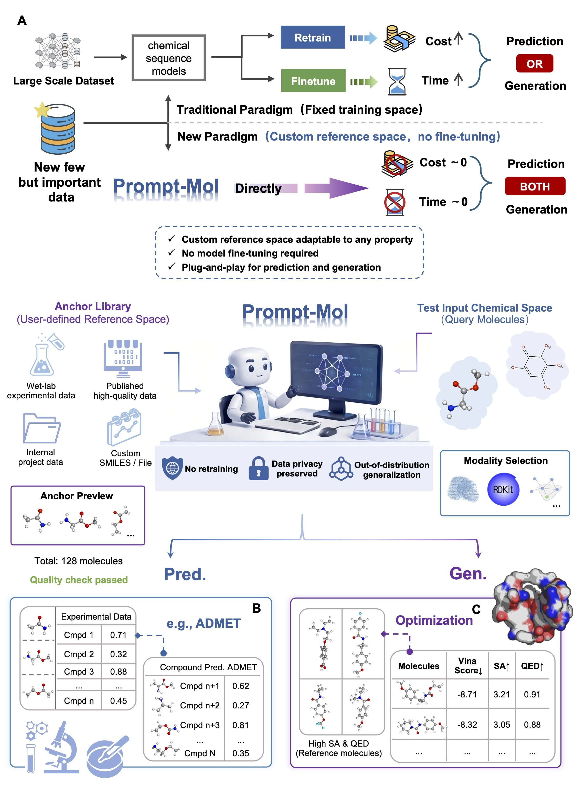

# Prompt-Mol

[](LICENSE.md)

Code for **Prompt-Mol: Reference-conditioned adaptation of chemical foundation models for molecular prediction and design**.

Prompt-Mol uses retrieved anchor molecules to condition chemical sequence models on task-relevant reference information. Chem-Semantic Pairing constructs anchor–query contexts through structural similarity, property consistency, and chemical contrast. Hard prompts and additional feature representations connect this reference context to molecular property prediction and protein-pocket-conditioned molecule generation.

After initial model training, users can change the **Anchor Library** supplied at inference time to incorporate a different chemical reference space without another parameter update. The training scripts provided here establish the model; the prediction and generation scripts use trained checkpoints with the selected reference molecules.



## Main workflows


| Workflow                                | Entry point                                     |
| --------------------------------------- | ----------------------------------------------- |
| Raw molecular data tokenization         | `data/gen_data/get_data.py`                     |
| ADMET property training                 | `train_prompt_mol.py --task property`           |
| Protein-conditioned generation training | `train_prompt_mol.py --task protein_generation` |
| Molecular property inference            | `pred_prompt_property.py`                       |
| Protein-conditioned molecule generation | `pred_protein_mol.py`                           |

The examples below follow the reference workflows in paper, with the task name, required protein-file arguments, and working-directory paths aligned with the current code.

## Environment

The core environment follows the supplied configuration.

### Python dependencies

```text
Python == 3.8
PyTorch == 1.13.1
RDKit == 2022.09.1
transformers == 4.24.0
networkx == 2.8.4
pandas == 1.5.3
scipy == 1.10.0
easydict (any version)
```

Additional packages imported by this repository include:

```text
numpy
scikit-learn
joblib
psutil
tqdm
descriptastorus
catboost
```

Versions for these additional packages are not pinned in the supplied environment template. Use a mutually compatible set and preserve the versions used to create serialized models and scalers. RDKit must include the Avalon fingerprint module used by `maplight.py`.

`GPT_meta.py` uses GPT-2 attention interfaces from the older Transformers implementation. Retain Transformers 4.24.0 unless the model code is adapted to another version.

### Software dependencies

**CUDA 11.6**, following the Token-Mol environment configuration.

The trainer supports CPU or CUDA through `--device`. Both current inference scripts load model weights with `map_location='cuda'`, so their unchanged execution paths require an available CUDA device.

For training datasets or Anchor Libraries larger than **10,000 molecules**, allocate **at least four CPU cores**. Retrieval also requires sufficient system memory; the current fingerprint implementation requests 18 worker processes, so account for this when scheduling larger jobs.

### Optional pocket encoding and docking

For custom pocket encoding with the upstream [ResGen workflow](https://github.com/HaotianZhangAI4Science/ResGen), the template lists these additional dependencies:

```text
pyg_lib == 0.4.0
torch_cluster == 1.6.1
torch_scatter == 2.1.1
torch_sparse == 0.6.17
torch_spline_conv == 1.2.2
biopython
```

These packages concern the external pocket encoder. The training and generation commands in this repository consume **precomputed protein representations**.

Optional docking/post-processing software :


| Software   | Source                                                                                |
| ---------- | ------------------------------------------------------------------------------------- |
| QuickVina2 | [Download](https://qvina.github.io/)                                                  |
| ADFRsuite  | [Download](https://ccsb.scripps.edu/adfr/downloads/)                                  |
| Open Babel | [Installation](https://open-babel.readthedocs.io/en/latest/Installation/install.html) |

These tools are not invoked by the training and inference commands below. If ADFRsuite changes which executable `python` resolves to, explicitly use the Python executable from the intended environment. 

## Data and model assets

The accompanying manuscript identifies the following data sources:


| Task                              | Source                                                    |
| --------------------------------- | --------------------------------------------------------- |
| Molecular property prediction     | [PharmaBench](https://github.com/mindrank-ai/PharmaBench) |
| Pocket-based molecular generation | [Generation dataset](https://zenodo.org/records/15194424) |

The supplied code directory uses the following layout:

```text
Prompt-Mol/
├── train_prompt_mol.py
├── pred_prompt_property.py
├── pred_protein_mol.py
├── GPT_meta.py
├── bert_tokenizer.py
├── prompts_nor.py
├── maplight.py
├── all_range.py
├── prompt_reg_voc.csv
├── prompt_mol.md
├── RTM_torsion_countinue_v2_epoch7_400/
├── cat_models/
│   └── scaffold_random/
└── data/
    ├── gen_data/
    ├── raw/
    ├── scaffold_random/
    ├── protein/
    └── SA/
```

Prompt-Mol initializes its GPT-based molecular model from the Token-Mol pretrained weights. Keep the compatible weights and configuration in `RTM_torsion_countinue_v2_epoch7_400/`. Use the same vocabulary and token ordering for training and inference. Changing the Anchor Library does not require changing this vocabulary.

### Molecular input format

Processed CSV files use the column `smiles_label_torsion_all`. Each row contains:

```text
<space-separated molecular tokens> GEO <optional geometry or placeholder tokens> <property_name> <numeric_value>
```

The current training and inference parsers use the molecular tokens before `GEO` and the final property-name/value pair. Property names, units, and normalization ranges must match `all_range.py` and `prompt_reg_voc.csv`.

For protein-conditioned tasks, each molecular row must correspond to one precomputed protein representation of shape `[L, D]`. Store these arrays as a list, or as sequentially pickled lists, with the same row order as the molecular CSV. The default generation feature dimension is `D=256`.

## Raw data preprocessing

The preprocessing input CSV must contain `smiles` and `value` columns. The current script takes the property name from the input CSV's parent-directory name; for example, a file under `raw/SA/` receives the `SA` label.

First set the project path. Replace the local path with the location of the supplied code directory on your machine:

```bash
export PROMPT_MOL_ROOT=""
```

Run tokenization from `data/gen_data`, where the tokenizer vocabulary is located:

```bash
cd "$PROMPT_MOL_ROOT/data/gen_data"

python get_data.py \
  --csv_path ../raw/SA/chembl_8k_mw.csv \
  --sdf_path ./sdfs/chembl_8k_mw.sdf \
  --save_path ../SA/chembl_8k_mw.csv
```

The active implementation produces tokenized CSV records, including `GEO` from the tokenizer and a `[UNK]` placeholder.`--sdf_path` is retained in the interface but does not create an SDF in this execution path. Existing processed CSVs can be used directly without rerunning preprocessing. Choose another `--save_path` to preserve an existing output.

## Execution setup

Both inference scripts retain relative paths such as `../RTM_torsion_countinue_v2_epoch7_400/`. With the current flattened code layout, run training and inference from a working directory **one level below the project root**, while invoking the scripts by their full paths:

```bash
mkdir -p "$PROMPT_MOL_ROOT/run" "$PROMPT_MOL_ROOT/results/protein"
cd "$PROMPT_MOL_ROOT/run"
```

All following examples assume this setup. This allows the existing model and protein-data paths to resolve without moving or editing Python files. The preprocessing command above uses its own working directory.

## Training

### ADMET property prediction

```bash
python "$PROMPT_MOL_ROOT/train_prompt_mol.py" \
  --task property \
  --code_dir "$PROMPT_MOL_ROOT" \
  --model_path "$PROMPT_MOL_ROOT/RTM_torsion_countinue_v2_epoch7_400" \
  --vocab_path "$PROMPT_MOL_ROOT/prompt_reg_voc.csv" \
  --train_raw_path "$PROMPT_MOL_ROOT/data/scaffold_random/caco2/train.csv" \
  --valid_raw_path "$PROMPT_MOL_ROOT/data/scaffold_random/caco2/valid.csv" \
  --save_model_path "$PROMPT_MOL_ROOT/fine_models/example" \
  --mix_feature rdkit \
  --lr 1e-5 --epochs 300 --batch_size 4 --k 3 \
  --extra_emb_dim 400
```

This mode constructs reference–query prompts and uses concatenated query/reference molecular descriptors as additional model input. The `rdkit` configuration uses a 400-dimensional feature vector. The initial training stage updates model parameters; changing the reference pool during subsequent inference is a separate operation.

### Protein-conditioned molecule generation

```bash
python "$PROMPT_MOL_ROOT/train_prompt_mol.py" \
  --task protein_generation \
  --code_dir "$PROMPT_MOL_ROOT" \
  --model_path "$PROMPT_MOL_ROOT/RTM_torsion_countinue_v2_epoch7_400" \
  --vocab_path "$PROMPT_MOL_ROOT/prompt_reg_voc.csv" \
  --train_raw_path "$PROMPT_MOL_ROOT/data/protein/mol_input_sa.csv" \
  --valid_raw_path "$PROMPT_MOL_ROOT/data/protein/val_mol_input_sa.csv" \
  --extra_raw_path "$PROMPT_MOL_ROOT/data/SA/chembl_8k_mw.csv" \
  --train_protein_path "$PROMPT_MOL_ROOT/data/protein/protein_represent.pkl" \
  --valid_protein_path "$PROMPT_MOL_ROOT/data/protein/val_protein_represent.pkl" \
  --save_model_path "$PROMPT_MOL_ROOT/fine_models/protein_example" \
  --lr 1e-5 --epochs 100 --batch_size 4 --k 1 \
  --extra_emb_dim 256
```

`protein_generation` is the accepted task name. Each target molecule is paired with anchors retrieved from the external library and conditioned on its corresponding protein representation. Both training and validation protein files are required. The protein encoder itself is not trained by this script.

### Important training arguments


| Argument                                       | Meaning                                                                                                                                                               |
| ---------------------------------------------- | --------------------------------------------------------------------------------------------------------------------------------------------------------------------- |
| `--task`                                       | `property` for molecular property prediction; `protein_generation` for protein-conditioned molecule generation.                                                       |
| `--train_raw_path`                             | Primary training molecular dataset.                                                                                                                                   |
| `--valid_raw_path`                             | Validation molecular dataset.                                                                                                                                         |
| `--extra_raw_path`                             | External Anchor Library for generation training; not used by the property-training branch.                                                                            |
| `--train_protein_path`, `--valid_protein_path` | Ordered protein-representation files for the corresponding molecular splits.                                                                                          |
| `--extra_emb_dim`                              | Dimension of the supplied additional features; 400 for the shown property setup and 256 for the shown protein setup. It does not select or compute an input modality. |
| `--mix_feature`                                | Property feature mode:`rdkit` or `des`. The inference example uses `rdkit`.                                                                                           |
| `--k`                                          | Retrieval limit used to construct reference prompts.                                                                                                                  |
| `--save_model_path`                            | Directory for the trained checkpoint and argument record.                                                                                                             |
| `--lambda_attn`, `--lambda_alig`               | Optional property-training auxiliary loss weights. Protein mode requires both to be zero; its defaults satisfy this.                                                  |
| `--prepare_only`                               | Prepare inputs without loading pretrained weights or starting training. It does not establish that all later inference paths are compatible.                          |

The training output includes `pytorch_model.pt` and `training_args.json` under `--save_model_path`. For inference, supply the `.pt` checkpoint through `--model_path`; during training the same argument instead points to the base pretrained-model directory.

## Inference

### Molecular property prediction

Use the training split as the built-in reference pool and optionally add a custom reference space through `--extra_raw_path`.

```bash
python "$PROMPT_MOL_ROOT/pred_prompt_property.py" \
  --train_raw_path "$PROMPT_MOL_ROOT/data/scaffold_random/caco2/train.csv" \
  --extra_raw_path "$PROMPT_MOL_ROOT/data/scaffold_random/caco2/extra.csv" \
  --test_raw_path "$PROMPT_MOL_ROOT/data/scaffold_random/caco2/test.csv" \
  --model_path "$PROMPT_MOL_ROOT/fine_models/example/pytorch_model.pt" \
  --vocab_path "$PROMPT_MOL_ROOT/prompt_reg_voc.csv" \
  --mix_feature rdkit \
  --k 3 --property_name caco2 \
  --cat_model_path "$PROMPT_MOL_ROOT/cat_models/scaffold_random" \
  --save_results "$PROMPT_MOL_ROOT/results/caco2_predictions.csv"
```

The target CatBoost model and scaler could be prepared; for this example they are `caco2_model.cbm` and `caco2_scaler.pkl` in the selected model directory. They provide property estimates used during reference retrieval. The test CSV still needs a numeric label for reporting and evaluation.


| Argument           | Meaning                                                                                                         |
| ------------------ | --------------------------------------------------------------------------------------------------------------- |
| `--train_raw_path` | Default inference reference pool, typically the original training set. No training is performed by this script. |
| `--extra_raw_path` | Optional custom reference space merged into the default pool.                                                   |
| `--test_raw_path`  | Query molecules with labels for evaluation.                                                                     |
| `--property_name`  | Property to predict; it must match the vocabulary, range configuration, and CatBoost assets.                    |
| `--cat_model_path` | Directory containing the target-property CatBoost model and scaler.                                             |
| `--k`              | Reference retrieval count per retrieval method.                                                                 |
| `--save_results`   | Optional file for individual prompt-level prediction records.                                                   |

The script prints aggregated predictions and RMSE, MAE, and Spearman correlation.

### Protein-conditioned molecule generation

```bash
python "$PROMPT_MOL_ROOT/pred_protein_mol.py" \
  --train_raw_path "$PROMPT_MOL_ROOT/data/SA/chembl_8k_mw.csv" \
  --test_raw_path "$PROMPT_MOL_ROOT/data/protein/test_mol_input_sa.csv" \
  --model_path "$PROMPT_MOL_ROOT/fine_models/protein_example/pytorch_model.pt" \
  --vocab_path "$PROMPT_MOL_ROOT/prompt_reg_voc.csv" \
  --k 4 \
  --save_results "$PROMPT_MOL_ROOT/results/protein/gen_example.csv"
```

The script reads test protein features from `../data/protein/test_protein_represent.pkl`, resolved from the `run/` directory to `Key_data/data/protein/test_protein_represent.pkl`. Match the feature list to the test molecular CSV in count and row order. Changing `--test_raw_path` alone does not select a different protein file.

Reference ligands in the test CSV are used to retrieve anchors from the selected library. The resulting prompts and pocket representations condition the generation of new molecules. The current entry point therefore expects pocket representations **and reference molecules**, rather than protein-only inputs.


| Argument           | Meaning                                                                                              |
| ------------------ | ---------------------------------------------------------------------------------------------------- |
| `--train_raw_path` | Anchor Library defining the available reference chemical space.                                      |
| `--test_raw_path`  | Reference/query ligands corresponding to the test protein representations.                           |
| `--model_path`     | Trained protein-generation checkpoint.                                                               |
| `--k`              | Number of Tanimoto-retrieved anchors; the implementation also retrieves one descriptor-based anchor. |
| `--save_results`   | Output file for generated molecular sequences.                                                       |

The inference parser retains integer defaults of 400 dimensions for property prediction and 256 for generation, but converts explicitly supplied `--extra_emb_dim` values to floats. The inference commands intentionally omit that argument. Nondefault feature dimensions require an interface adaptation. The generation decoder is specialized to `<SA>`.

## Citation

If you use Prompt-Mol, please cite the accompanying manuscript:

> Meijing Fang, Rui Qin, Yifei Liu, et al. **Reference-conditioned adaptation of chemical foundation models for molecular prediction and design.**

## Acknowledgements

Prompt-Mol builds on the Token-Mol molecular sequence-modeling framework. The environment configuration above follows the supplied Token-Mol README. Pocket-representation workflows draw on ResGen. 

## License

See [LICENSE.md](LICENSE.md) for the MIT license and retained copyright notice.
